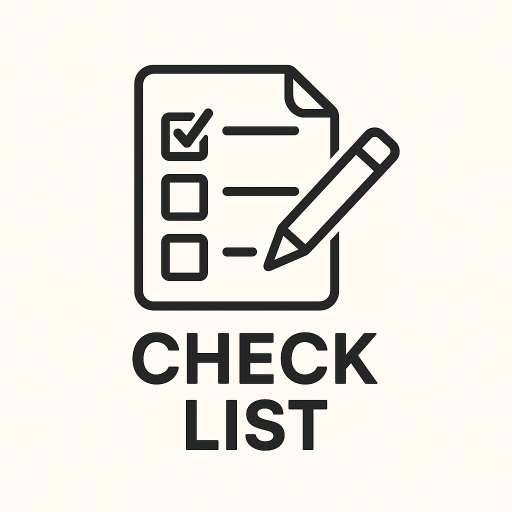

# Check-List



[](https://en.cppreference.com/w/cpp/23)

[Документация на русском языке](README_RU.md)

## Description

Check-List is a multifunctional task management application

- **Command Line Interface (CLI)** - for local task management

The application allows you to create, view, edit, mark as completed, and delete tasks. All data is stored in JSON format, which ensures easy storage and portability.

## Features

### CLI Utility (todo)

- Adding new tasks
- Viewing all tasks
- Viewing completed and pending tasks separately
- Editing task text
- Marking tasks as completed/pending
- Deleting tasks
- Clearing the entire task list
- Setting the path for task files storage
- Setting the filename for the task list

## Build Requirements

### Linux

The following dependencies are required to build the project:

- **C++ Compiler** with C++23 support (GCC 13 or higher)
- **CMake** version 3.31 or higher
- **Conan** version 2.22.2 or higher
- **Python 3** (for Conan)

### Project Dependencies

The project uses the following libraries:

- **nlohmann_json** 3.12.0
- **magic_enum** 0.9.7
- **GTest** 1.17.0 (For tests)

All dependencies are automatically installed via Conan during project build.

## Build Instructions for Linux

### 1. Clone the Repository

```bash
git clone https://github.com/Joraslav/check-list.git
cd check-list
```

### 2. Environment Setup

Create an environment for building (Debug or Release):

```bash
chmod +x scripts/create_env.sh
./scripts/create_env.sh Release
```

or for debug build:

```bash
./scripts/create_env.sh Debug
```

### 3. Building the Project

Use the build script:

```bash
chmod +x scripts/build.sh
./scripts/build.sh
```

Or build manually:

```bash
cmake --preset conan-release -DBUILD_TEST=ON -DDEV_MODE=OFF
cmake --build --preset conan-release
```

### 4. Running Tests

After building, you can run tests:

```bash
ctest --test-dir build/Release
```

## Usage

### CLI Utility

After building, the `todo` executable will be located in the `build/Release/` directory:

```bash
# View help
./todo help

# Add a task
./todo add "Buy groceries"

# View all tasks
./todo list

# View pending tasks
./todo list pending

# View completed tasks
./todo list completed

# Mark task as completed/pending
./todo done 0

# Edit a task
./todo edit 0 "Buy vegetables and fruits"

# Remove a task
./todo remove 0

# Clear all tasks
./todo clear

# Set path for task files storage
./todo config path "/home/user/my_tasks"

# Set filename
./todo config name "my_todo_list.json"
```

## Project Structure

```planetext
check-list/
├── src/
│   ├── task/          # Task management module
│   └──parser/         # Command line parser
├── tests/             # Unit tests
├── scripts/           # Build and setup scripts
├── profiles/          # Conan build profiles
├── resources/         # Project resources
├── CMakeLists.txt     # Main CMake build file
├── conanfile.txt      # Project dependencies
└── Dockerfile         # Docker file for building
```

## Docker

The project can also be built and run using Docker:

```bash
docker build -t check-list .
```

## License

This project is licensed under the BSD 3-Clause License - see the [LICENSE](LICENSE) file for details.
